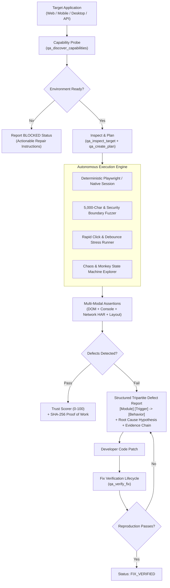
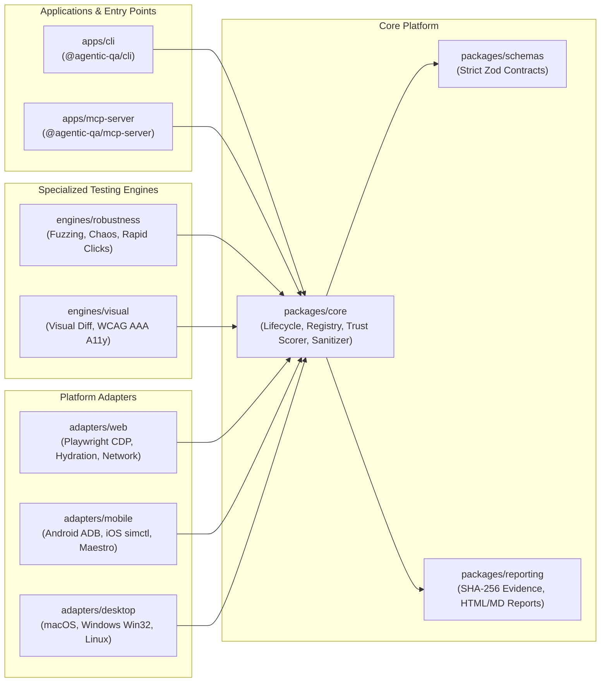

# Universal Agentic QA Engine

[](https://github.com/agentic-qa/universal-agentic-qa-engine/actions/workflows/ci.yml)
[](LICENSE)
[](package.json)
[](tsconfig.json)
[](tests/)
[](#the-problem-why-standard-ai-qa-fails)

A deterministic, open-source, AI-agent-driven QA automation engine designed for autonomous software verification across **Web**, **Mobile** (Android/iOS), **Desktop** (macOS/Windows/Linux), **API**, and **Game** environments.

---

## The Problem: Why Standard AI QA Fails

When developers ask standard AI models or generic automated scripts to "test an application," the results are consistently unreliable:

| Failure Pattern | Standard AI Testing Behavior | Universal Agentic QA Engine Behavior |
| :--- | :--- | :--- |
| **Sycophancy & False Passes** | Clicks 2 happy-path buttons, ignores console exceptions, and reports: *"Everything looks great!"* | **Zero Hallucinated Passes**: Enforces deterministic assertions. If an error exists, the test fails with cryptographic proof. |
| **Missing Missing-Tool Truth** | If Chrome or ADB is missing, it fabricates a pass or skips silently. | Truthfully marks the run as **`BLOCKED`** and outputs the exact command required to fix the host environment. |
| **Shallow Assertions** | Checks `HTTP 200` on a crash screen or verifies `expect(page).toBeDefined()`. | Validates React hydration (`#418`, `#423`), element occlusion, layout overflow, and WCAG 2.2 AAA 44x44 tap targets. |
| **Lack of Edge-Case Fuzzing** | Only enters valid words like `"test"`, `"admin"`, or `"12345"`. | Automatically injects **5,000+ character boundaries**, Big List of Naughty Strings (BLNS), RTL overrides, and prototype pollution. |
| **Double-Click Race Conditions** | Clicks buttons once with artificial 1-second delays. | Executes rapid multi-click bursts (sub-10ms) to detect broken debouncing, duplicate API mutations, and UI thread locking. |
| **Fix Verification Loopholes** | Asserts a bug is "fixed" as soon as a file is edited without re-testing the original reproduction steps. | Transitions defects to **`FIX_VERIFIED`** *only* when the exact failing scenario re-runs against the patched code and truthfully passes. |

---

## Verification Pipeline & Architecture

### Autonomous Verification Pipeline



### Monorepo Structure



---

## Quickstart for Developers

### Prerequisites
- **Node.js**: `>= 20.0.0`
- **pnpm**: `>= 9.0.0` or `10.0.0`

### 1. Installation & Build

```bash
git clone https://github.com/agentic-qa/universal-agentic-qa-engine.git
cd universal-agentic-qa-engine
pnpm install
pnpm run build
```

Run test suite to verify 100% environment integrity:
```bash
pnpm test
```

### 2. Environment Audit (`doctor`)

Check your system dependencies (browsers, device tools, emulators):
```bash
./apps/cli/bin/qa.js doctor
```

---

## Real-World CLI Testing Workflows

### Testing a Local Web Application (Next.js / React / Vue / Vite)

1. **Start your application** in its project directory:
   ```bash
   npm run dev
   # Target is live at http://localhost:3000
   ```

2. **Inspect target accessibility and structure**:
   ```bash
   ./apps/cli/bin/qa.js inspect http://localhost:3000
   ```

3. **Execute smoke and accessibility tests**:
   ```bash
   ./apps/cli/bin/qa.js test --target http://localhost:3000
   ```

4. **Execute rapid clicks & race condition debounce test**:
   ```bash
   ./apps/cli/bin/qa.js test --target http://localhost:3000 -c qa.config.json
   ```

5. **Execute autonomous chaos monkey exploration**:
   ```bash
   ./apps/cli/bin/qa.js explore --target http://localhost:3000 --max-steps 50 --engine monkey
   ```

6. **Verify a bug fix after patching code**:
   ```bash
   ./apps/cli/bin/qa.js verify-fix --finding-id FIND-8201 --target http://localhost:3000
   ```

---

### Testing Mobile Applications (Android & iOS)

```bash
# Android (via ADB with dynamic screen detection & LMK process death testing)
./apps/cli/bin/qa.js test --platform android --target com.example.myapp

# iOS Simulator (via simctl deep linking & state restoration)
./apps/cli/bin/qa.js test --platform ios --target com.example.myapp
```

---

### Testing Desktop Applications (macOS / Windows / Linux)

```bash
./apps/cli/bin/qa.js test --platform desktop --target "/Applications/MyApp.app"
```

---

## 🤖 Guide for AI Coding Agents (Claude, Gemini, Antigravity, Cursor, Windsurf)

If you are an **AI Agent** reading this repository to test an application, follow this contract:

### 1. Connect via Model Context Protocol (MCP)

Add the engine to your MCP client configuration:

```json
{
  "mcpServers": {
    "agentic-qa": {
      "command": "node",
      "args": [
        "/ABSOLUTE/PATH/TO/universal-agentic-qa-engine/apps/mcp-server/dist/index.js"
      ]
    }
  }
}
```

### 2. Standard Autonomous Execution Flow

```
1. qa_discover_capabilities ──► Verify adapter status. If BLOCKED, prompt host to install tool.
2. qa_inspect_target        ──► Identify platform, DOM nodes, interactive controls, and routes.
3. qa_create_plan           ──► Generate strict test scenarios matching TestPlanSchema.
4. qa_execute_test          ──► Run scenarios with deterministic assertions and boundary payloads.
5. qa_get_evidence          ──► Retrieve SHA-256 evidence (screenshot, console, network trace).
6. qa_generate_report       ──► Emit tripartite defect report with rootCauseHypothesis.
7. qa_verify_fix            ──► Re-run failing scenario against patched code. Only claim fixed if verified.
```

### 3. Available MCP Tools Reference

| Tool Name | Parameters | Output / Contract |
| :--- | :--- | :--- |
| `qa_discover_capabilities` | None | Truthful capability matrix (`AVAILABLE`, `BLOCKED`, `UNAVAILABLE`, `UNSUPPORTED`) across all platforms. |
| `qa_inspect_target` | `target` (string), `platform` (optional) | Deep scan of reachable endpoints, DOM elements, and console warnings. |
| `qa_create_plan` | `target`, `platform`, `scenarios` | Strictly-typed Zod schema validation for test scenarios. |
| `qa_execute_test` | `plan` (object) or `planId` (string) | Executes steps, captures SHA-256 evidence, records findings, and computes Trust Score (0–100). |
| `qa_get_evidence` | `artifactId` (string) | Cryptographically verifies SHA-256 checksum and returns artifact bytes/text. |
| `qa_generate_report` | `reportId` (string), `format` (`html` \| `markdown` \| `json`) | Generates human and machine readable reports with tripartite defect taxonomy. |
| `qa_verify_fix` | `findingId` (string), `target` (string) | Reconstructs exact failing scenario and verifies genuine resolution. |

### 4. Mandatory Defect Taxonomy Format

Every defect reported by an agent must follow the **Tripartite Standard**:
```
[Module/Feature] [Condition/Trigger] -> [Unexpected Behavior]
```

**Example:**
- `[Checkout/Payment] Rapid double-click on 'Pay Now' -> Triggers duplicate Stripe charge requests (Race Condition)`
- `[Registration/Form] Submitting 5,000-character string in username field -> Unhandled Server 500 DB Truncation Exception`
- `[Navigation/Header] Viewport resize below 360px -> Horizontal layout overflow of 48px on document.body`

---

## Security, Sandboxing & Privacy

The engine is engineered to run safely across development, staging, and CI environments:
- **Zero Secret Leakage**: `Cookie`, `Set-Cookie`, `Authorization: Bearer`, and OAuth query tokens (`code=`, `token=`, `session=`, `sig=`) are automatically redacted at capture time.
- **SSRF Mitigation**: Outbound navigation to cloud metadata endpoints (`http://169.254.169.254`) is strictly blocked.
- **Sandboxed Browser Contexts**: Ephemeral browser sessions without `--no-sandbox` bypasses.
- **Tamper-Resistant Evidence**: All screenshots, logs, and traces are fingerprinted with SHA-256 checksums to eliminate falsified reports.

---

## Monorepo Packages

| Package | Path | Purpose |
| :--- | :--- | :--- |
| `@agentic-qa/schemas` | `packages/schemas` | Strict Zod contracts, assertion models, and finding structures. |
| `@agentic-qa/core` | `packages/core` | RunLifecycle orchestration, CapabilityRegistry, and secret sanitization. |
| `@agentic-qa/adapter-web` | `packages/adapters/web` | Playwright CDP adapter, React hydration interceptor, occlusion detection. |
| `@agentic-qa/adapter-mobile` | `packages/adapters/mobile` | Android ADB (LMK process death), iOS simctl, Maestro YAML generator. |
| `@agentic-qa/adapter-desktop`| `packages/adapters/desktop` | Native OS screencapture, Win32/macOS window manager, AltTester protocols. |
| `@agentic-qa/engine-robustness`| `packages/engines/robustness` | 5,000-char boundary fuzzer, rapid interaction runner, FSM monkey explorer. |
| `@agentic-qa/engine-visual` | `packages/engines/visual` | Pixel-level visual regression, WCAG 2.2 AAA 44x44 target audit. |
| `@agentic-qa/reporting` | `packages/reporting` | SHA-256 evidence store, trust scorer (0-100), HTML/Markdown reports. |
| `@agentic-qa/cli` | `apps/cli` | Developer command-line tool `qa`. |
| `@agentic-qa/mcp-server` | `apps/mcp-server` | Stdio Model Context Protocol server for AI coding assistants. |

---

## Contributing & Development

```bash
# Clone and link workspace packages
pnpm install

# Run type checking across all 10 packages
pnpm run typecheck

# Run tests in watch mode during development
pnpm run test:watch
```

---

## License

Universal Agentic QA Engine is open-source software licensed under the **[Apache License 2.0](LICENSE)**.
