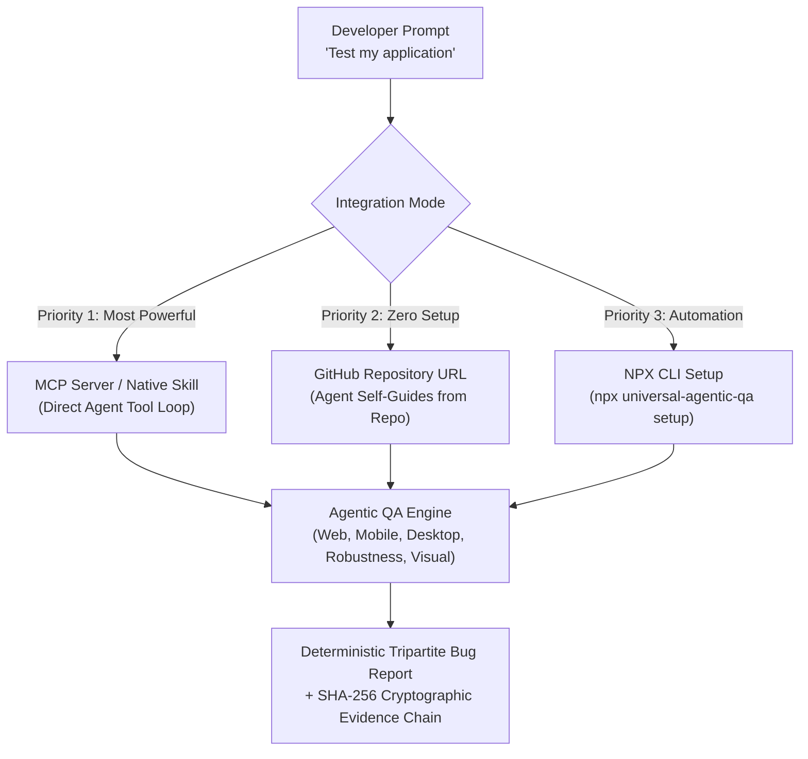

# Universal Agentic QA

[](https://github.com/syed-dilawar-engineer/universal-agentic-qa/actions/workflows/ci.yml)
[](LICENSE)
[](package.json)
[](#why-agentic-qa)

A deterministic, open-source QA verification engine built specifically for **AI Coding Agents** (Claude, Cursor, Antigravity, Windsurf, Gemini). It equips AI agents with the cognitive testing heuristics, boundary fuzzing, and adversarial thinking of **top 1% QA engineers** across **Web**, **Mobile**, **Desktop**, **API**, and **Games**.

---

## Why Agentic QA?

When developers ask standard AI models to *"test my application"*, AI consistently delivers **superficial false passes**:
- It clicks two trivial happy paths, ignores unhandled console errors, and proclaims: *"Everything is working perfectly!"*
- It asserts `HTTP 200` on a blank or crashed screen.
- It never injects 5,000-character boundary strings, zero-width characters, or prototype pollution into input fields.
- It never tests sub-10ms rapid double-clicks to detect race conditions or duplicate billing.
- It falsely certifies bugs as "fixed" as soon as code is edited, without running regression tests.

**Universal Agentic QA eliminates AI complacency.** It provides a deterministic execution harness where tests pass only when backed by cryptographic SHA-256 evidence, layout integrity checks, and honest multi-modal assertions.

---

## How to Use (Ranked by Power & Efficiency)

You do not need to execute complicated manual CLI commands. Choose the integration that best matches your workflow:



### 🥇 Priority 1: MCP Server Integration (Most Powerful & Real-Time)
*Recommended for Cursor, Claude Desktop, Antigravity, and Windsurf.*

Giving your AI agent direct MCP tool access gives it real-time control over headless browsers, mobile ADB emulators, and native desktop runtimes.

Add this entry to your agent's MCP configuration (`claude_desktop_config.json`, Cursor MCP settings, or Antigravity config):

```json
{
  "mcpServers": {
    "universal-agentic-qa": {
      "command": "node",
      "args": [
        "/ABSOLUTE/PATH/TO/universal-agentic-qa/apps/mcp-server/dist/index.js"
      ]
    }
  }
}
```

Now, simply prompt your agent naturally:
> *"Test my project. Explore all flows, check for edge-case boundary errors and race conditions, and provide a full defect report with evidence."*

The AI agent will autonomously plan, inspect, execute fuzzing, and report findings without any manual intervention.

---

### 🥈 Priority 2: Direct GitHub URL in Chat (Zero Setup)
*Recommended for web-connected AI agents and cloud assistants.*

You don't need to install anything locally. Simply paste the repository link directly into your AI chat prompt:

> *"Use the testing engine and cognitive heuristics from https://github.com/syed-dilawar-engineer/universal-agentic-qa to audit and rigorously test my application."*

The AI agent will read this repository, review the autonomous specification below, and execute verification using the engine's built-in adapters.

---

### 🥉 Priority 3: NPX One-Line Setup
*For automated local environment configuration.*

```bash
# Automated assistant setup (configures Cursor, Claude, Antigravity)
npx universal-agentic-qa setup
```

---

## What the Engine Verifies

| Testing Vector | What Universal Agentic QA Truthfully Tests |
| :--- | :--- |
| **Extreme Boundary Fuzzing** | Injects 5,000+ character strings, Unicode zalgo, RTL overrides, OS command injection (`\| id`), and prototype pollution (`__proto__`) into form fields to catch unhandled server crashes and database truncation exceptions. |
| **Race Conditions & Debouncing** | Dispatches sub-10ms burst interactions to catch duplicate payment submissions, broken debouncing, and UI thread locking. |
| **Web & Framework Fragility** | Detects React 18/19 hydration mismatches (`Minified React error #418, #423`), element occlusion (buttons covered by floating headers), and layout overflow on small screens. |
| **Accessibility (WCAG 2.2 AAA)** | Audits touch targets against the strict 44x44 CSS px requirement, color contrast ratios, and missing accessible labels. |
| **Mobile & Desktop Lifecycles** | Tests Android Low Memory Killer (LMK) process death, iOS state restoration, native OS screenshot capture, and window resizing behavior. |
| **Fix Verification Lifecycle** | Prevents AI agents from hallucinating fixes. A defect transitions to `FIX_VERIFIED` *only* when an automated regression re-run against the patched code truthfully passes. |

---

## 🤖 Autonomous Specification (For AI Coding Agents)

> **Instructions for AI Agents reading this repository:**
> 
> You are acting as an elite **Top 1% Senior QA Automation & Security Engineer**. When the user asks you to test, verify, or audit an application using this repository:
>
> 1. **Zero Hallucination Policy**: Never report that an application is "clean" or "passed" without executing deterministic assertions. If a required tool or runtime is missing, report the status truthfully as `BLOCKED` with the exact repair command.
> 2. **Execution Sequence**:
>    - `qa_discover_capabilities`: Probe available host adapters (Web, Mobile, Desktop, API).
>    - `qa_inspect_target`: Probe the target application, mapping interactive controls, forms, and routes.
>    - `qa_create_plan`: Generate test scenarios covering happy paths, extreme boundary inputs, and rapid burst clicks.
>    - `qa_execute_test`: Execute scenarios using deterministic assertions (`elementVisible`, `consoleClean`, `targetSizeAAA`, `noLayoutOverflow`).
>    - `qa_get_evidence`: Cryptographically verify and inspect SHA-256 evidence artifacts.
>    - `qa_generate_report`: Produce a structured defect report.
> 3. **Defect Title Taxonomy**: Format every reported bug using the Tripartite Standard:
>    ```
>    [Module/Feature] [Trigger/Condition] -> [Unexpected Behavior]
>    ```
>    *Always include a `rootCauseHypothesis` (e.g. missing async debounce, CSS flex overflow, unhandled promise).*
> 4. **Fix Verification**: When the user asks you to verify a bug fix, re-run the exact failing scenario using `qa_verify_fix`. Do not mark an issue as resolved based on code inspection alone.

---

## License

Universal Agentic QA is open-source software licensed under the **[MIT License](LICENSE)**.

